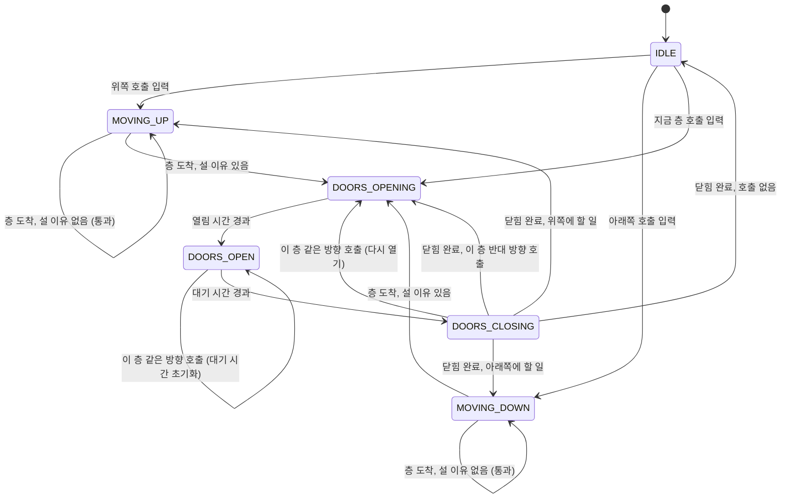
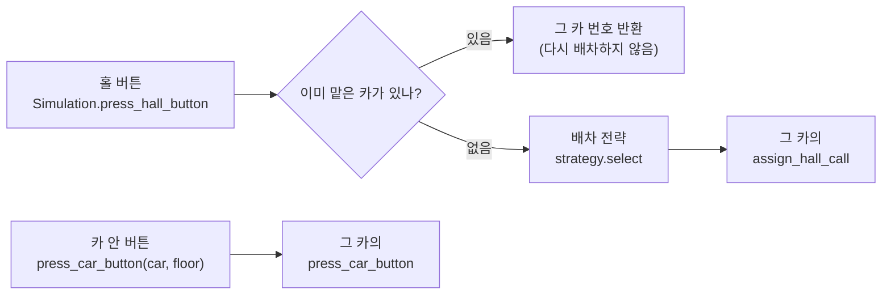
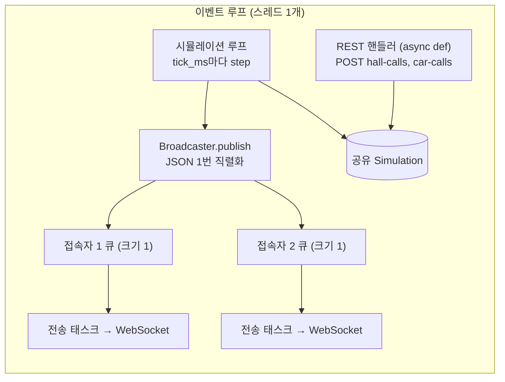

# 설계 문서: 엘리베이터 시뮬레이션 (1~3단계)

1단계는 단일 엘리베이터 상태 머신(1~3절), 2단계는 여러 대와 배차 전략(4절), 3단계는 실시간 서버(5절)입니다. 엔진 코드는 `app/simulation/`에 있습니다. 순수 파이썬이고 I/O, asyncio, 실제 시계에 의존하지 않습니다.

## 1. 상태 머신

### 상태를 이렇게 나눈 이유

| 상태 | 의미 | 왜 따로 두는가 |
|---|---|---|
| `IDLE` | 서 있고, 문 닫힘, 할 일 없음 | 새 호출이 오면 "바로 판단"해야 하는 유일한 상태 |
| `MOVING_UP` / `MOVING_DOWN` | 층 사이를 이동 중 | 화면에 화살표를 그리고, 운행 기록에서 이동 시간·거리를 셀 때 방향이 바로 보인다 |
| `DOORS_OPENING` | 문이 열리는 중 | 시간이 걸리는 동작이다. 닫히는 중에 다시 열 때 "닫힌 만큼만" 여는 계산에 필요 |
| `DOORS_OPEN` | 문이 완전히 열려 있음 | 이때만 승객이 타고 내린다. 같은 층 호출이 오면 대기 시간을 다시 센다 |
| `DOORS_CLOSING` | 문이 닫히는 중 | 실제 엘리베이터처럼 이 층 버튼을 누르면 다시 열린다 |

- **문 상태를 셋으로 나눈 이유**: "문 열림" 하나로 합치면, 닫히는 중에 버튼을 눌렀을 때 다시 여는 동작과 시간 계산을 표현할 수 없습니다. 나중에 6단계(고장 감지)에서 "문이 N초 넘게 닫히지 않음" 같은 규칙을 만들 때도 상태가 나뉘어 있어야 합니다.
- **상태(`state`)와 진행 방향(`direction`)을 따로 둔 이유**: 상태는 "지금 물리적으로 하는 일", 방향은 "다음에 어느 쪽으로 갈 의도인지"입니다. 문이 열려 있는 동안에도 방향을 기억해야 같은 방향 홀 호출만 처리하고, 문이 닫힌 뒤 어느 쪽으로 갈지 정할 수 있습니다. 이동 중에는 `MOVING_UP`이면 항상 `direction == UP`이고, `IDLE`이면 항상 `NONE`입니다(테스트로 확인하는 불변식).
- **고려했지만 쓰지 않은 상태**:
  - `STOPPING`(감속): 층에 닿기 전에 정지를 결정하는 모델입니다. 현실적이지만 "이미 감속 거리 안이라 못 서는" 규칙이 추가로 필요합니다. 1단계에서는 층에 도착하는 순간 정지를 결정하는 것으로 단순화했습니다.
  - `OUT_OF_SERVICE`(고장, 점검): 6단계에서 추가합니다.

### 상태가 바뀌는 사건은 두 가지뿐

1. **시간 경과** `tick(dt_ms)`: 이동, 문 동작처럼 시간이 걸리는 일이 끝나면 다음 상태로 갑니다.
2. **호출 입력** `press_car_button`, `assign_hall_call`: `IDLE`이면 곧바로 판단해 출발하고, 문이 열린 층의 호출이면 그 자리에서 처리합니다. 이동 중에 들어온 호출은 다음 층에 도착할 때 반영됩니다.

이렇게 나누면 상태 전이가 일어나는 곳이 `_complete_phase`(시간)와 `_on_new_call`(입력) 두 군데로 모여서 추적하기 쉽습니다.

## 2. 운행 방식: LOOK

**규칙**: 진행 방향 앞쪽에 호출이 남아 있으면 그 방향으로 계속 가며, 지나가는 층의 카 호출과 *같은 방향* 홀 호출에서 섭니다. 앞쪽에 더 할 일이 없으면 방향을 바꿉니다.

층에 도착했을 때 서는 조건 (`Elevator._on_arrive`):

- 그 층의 카 호출이 있다
- 그 층에 진행 방향과 같은 홀 호출이 있다
- 진행 방향 앞쪽에 더 할 일이 없다 (반환점, 반대 방향 홀 호출을 태우고 방향을 바꾼다)

### 다른 방식과 비교

| 방식 | 동작 | 장점 | 단점 |
|---|---|---|---|
| **FCFS** (먼저 온 순서) | 호출이 들어온 순서대로 한 층씩 간다 | 가장 단순하고 공정해 보인다 | 1층→9층→2층→8층처럼 왔다 갔다 해서 이동 거리와 대기 시간이 크게 늘어난다. 지나가는 층의 손님을 태우지 않는다 |
| **SCAN** (엘리베이터 알고리즘) | 한 방향으로 **건물 끝까지** 간 뒤 방향을 바꾼다 | 굶주림(영원히 못 타는 호출)이 없다 | 호출이 없는 맨 위층, 맨 아래층까지 쓸데없이 간다 |
| **LOOK** (채택) | 한 방향으로 **마지막 호출까지만** 간 뒤 방향을 바꾼다 | SCAN의 장점(굶주림 없음, 지나가며 태우기)을 유지하면서 빈 구간 이동을 없앤다 | 방향 끝 쪽 손님은 한 바퀴를 기다릴 수 있다 |

- LOOK을 고른 이유: 실제 단일 엘리베이터의 동작(집합 제어)과 가장 비슷하고, SCAN보다 이동 거리가 짧습니다. 굶주림이 없다는 점은 `test_all_calls_are_eventually_served`(시드 20개)로 확인합니다. SCAN과의 차이는 `test_look_turns_at_last_call_not_at_top_floor`에 그대로 드러납니다.
- 이름은 디스크 스케줄링에서 온 것입니다. 디스크 헤드가 트랙을 오가는 문제와 엘리베이터가 층을 오가는 문제가 같은 구조라서 같은 이름을 씁니다.

### 세부 규칙 (애매한 경우를 어떻게 정했는가)

- **반대 방향 홀 호출**: 올라가는 중에 "내려감" 버튼을 누른 층은 지나칩니다. 그 손님이 타면 반대쪽으로 끌려가기 때문입니다. 단, 그 층이 진행 방향의 마지막 호출이면 그 층이 반환점이 되어 섭니다.
- **문이 열린 동안 들어온 호출**
  - 지금 층의 카 호출, 같은 방향 홀 호출: 등록하지 않고 바로 처리합니다. `DOORS_OPEN`이면 대기 시간을 처음부터 다시 세고, `DOORS_CLOSING`이면 문을 다시 엽니다(닫힌 만큼만 다시 열리므로 그만큼 시간이 걸림).
  - 지금 층의 반대 방향 홀 호출: 남겨 두고 나중에 처리합니다.
  - 다른 층 호출: 등록만 하고, 문이 닫힌 뒤 판단합니다(문을 연 채 출발하지 않음).
- **대기 중 첫 출발 방향**: 가장 가까운 호출 쪽, 거리가 같으면 위쪽입니다. 대기 중에는 호출이 들어오는 즉시 판단하므로, 이 규칙은 문이 열린 동안 여러 호출이 쌓였을 때만 쓰입니다.
- **같은 호출 중복**: 호출을 집합(`set`)에 담으므로 여러 번 눌러도 한 번만 남고, 한 번만 섭니다.
- **맨 위층의 올라감, 맨 아래층의 내려감**: 실제로 버튼이 없으므로 `ValueError`로 거절합니다. 거절된 호출은 상태를 바꾸지 않습니다.
- **호출을 지우는 시점**: 문이 열리기 시작할 때(`DOORS_OPENING` 진입) 지웁니다. 실제 엘리베이터가 도착하면 버튼 불이 꺼지는 시점과 같습니다.

## 3. 시간과 결정성

### 정수 밀리초

시간은 `float` 초가 아니라 `int` 밀리초입니다.

- `0.1`을 10번 더하면 `0.9999999999999999`가 되어 `1.0`과 같지 않습니다. 도착 여부를 `>=`로 비교하면 한 tick 늦게 도착하는 일이 생기고, tick 크기에 따라 결과가 달라집니다.
- 정수는 이런 오차가 없습니다. `Fraction`이나 `Decimal`도 가능하지만 느리고, ms 해상도면 엘리베이터에는 충분합니다.

### tick 크기와 무관한 결과

`tick(dt_ms)`에서 한 동작이 dt보다 일찍 끝나면 남은 시간을 다음 동작에 넘깁니다(`while` 루프). 그래서 `tick(1)`을 6만 번 하든 `tick(60000)`을 한 번 하든 상태 기록(`history`)이 같습니다. 3단계 실시간 서버에서 tick 간격을 바꾸거나 4단계 실험에서 빠르게 돌려도 결과가 바뀌지 않습니다.

`Simulation.step`도 같은 원칙으로, tick 사이에 예약된 호출을 tick 경계로 미루지 않고 그 시각에 정확히 넣습니다.

### 같은 입력이면 같은 결과

- 엔진 자체에는 무작위성이 없습니다. 같은 호출을 같은 시각, 같은 순서로 넣으면 결과가 같습니다.
- 같은 시각의 호출은 예약한 순서대로 처리합니다(힙에 `(시각, 순번, 호출)`을 넣음). 같은 시각에 끝나는 동작(예: 문 닫힘 완료)이 있으면 동작이 먼저 끝나고 호출이 들어갑니다.
- 무작위 호출은 `traffic.py`에서만 만들고, 전역 `random`이 아니라 시드로 만든 `random.Random(seed)`를 씁니다. 전역 상태를 쓰면 다른 코드가 난수를 하나만 더 뽑아도 순서가 바뀌기 때문입니다.
- 홀 호출 집합의 순회 순서는 실행마다 달라질 수 있습니다(방향이 문자열이라 해시가 `PYTHONHASHSEED`에 따라 바뀜). 그래서 판단 로직은 `any`, 동점이 없는 `min`처럼 순서와 무관한 연산만 쓰고, 방향을 고를 때는 `(UP, DOWN)` 같은 고정된 순서로 확인합니다.

이 성질은 4단계에서 배차 알고리즘들을 **같은 시드, 같은 호출**로 비교하는 기반입니다.

## 4. 여러 대와 배차 전략 (2단계)

### 호출이 흘러가는 길

- **홀 호출은 건물이, 카 호출은 카가 받습니다.** 홀 버튼은 층에 있어서 어느 카가 갈지 정해야 하고, 카 버튼은 이미 그 카 안에 탄 사람이 누르는 것이라 배차가 필요 없습니다.
- 1단계의 `Elevator`는 거의 그대로 두었습니다. `press_hall_button`을 `assign_hall_call`로 이름만 바꿨습니다. 카 입장에서는 "누가 눌렀다"가 아니라 "이 호출을 맡았다"이기 때문입니다. 1단계 엔진은 처음부터 "카가 가진 호출"만 보고 움직이도록 만들어서, 여러 대로 늘려도 카 내부 로직(LOOK)은 고칠 필요가 없었습니다.
- 시계(`now_ms`)는 `Simulation`이 갖고, 모든 카를 같은 시간만큼 `tick`합니다. 카끼리는 tick 동안 서로 영향을 주지 않으므로(상호작용은 배차 순간뿐), 번호 순서대로 진행해도 결과가 같습니다.
- 배차 기록(`Assignment`: 시각, 호출, 카)을 남깁니다. 4단계 비교와 5단계 DB 저장에 씁니다.

### Strategy 패턴

`DispatchStrategy`(추상 클래스)의 `select(call, elevators) -> 카 번호` 하나만 구현하면 새 전략이 됩니다. `Simulation`은 `select`만 부르고 전략의 내부를 모릅니다.

- **왜 Strategy 패턴인가**: 4단계에서 알고리즘 2~3개를 같은 시드, 같은 호출로 바꿔 끼우며 비교해야 합니다. `if strategy == "nearest": ... elif ...`로 시뮬레이션 안에 분기를 넣으면 알고리즘을 추가할 때마다 시뮬레이션 코드를 고쳐야 하고, 각 알고리즘을 따로 테스트하기도 어렵습니다.
- **ABC를 고른 이유**: `select`를 빠뜨린 전략은 객체를 만드는 순간 `TypeError`가 납니다. `typing.Protocol`(구조적 타이핑)도 가능합니다. 그쪽은 상속 없이 메서드 모양만 맞으면 되므로 외부 코드를 끼울 때 유리합니다. 하지만 전략은 이 프로젝트 안에서만 만들므로, 상속으로 "배차 전략이다"를 명시하는 편이 읽기 쉽습니다.
- **전략도 결정적이어야 합니다**: 무작위로 고르지 않고, 동점이면 번호가 작은 카를 고릅니다.

### Nearest Car (가장 가까운 차)

단순히 거리가 가장 짧은 카를 고르면, 바로 위층에 있지만 위로 *멀어지는* 카가 뽑혀 한 바퀴를 돌고 와야 합니다. 그래서 교과서 정의(Barney, *Elevator Traffic Handbook*)대로 진행 방향까지 따진 **적합도(Figure of Suitability, FS)**가 가장 큰 카를 고릅니다. N = 층 수 - 1, d = 카 위치와 호출 층의 거리입니다.

| 카의 상황 | FS | 이유 |
|---|---|---|
| 호출 쪽으로 오는 중, 호출과 같은 방향 | N + 2 - d | 가는 길에 태울 수 있다 |
| 호출 쪽으로 오는 중, 호출과 반대 방향 | N + 1 - d | 지나쳤다가 돌아와야 할 수 있다 |
| 대기 중 | N + 1 - d | 바로 출발할 수 있다 |
| 호출에서 멀어지는 중 | 1 | 거리와 상관없이 가장 나쁘다 |

- "오는 중"의 판단: 이동 중인 카는 이미 떠난 층에는 설 수 없으므로 *다음 층*부터 따집니다. 서 있는(문이 열린) 카는 지금 층을 포함합니다.
- 거리 d는 층 사이 위치(`position`, 예: 3.5층)로 잽니다.
- **배차는 호출이 들어온 순간 한 번만 합니다(정적 배차).** 나중에 더 좋은 카가 생겨도 다시 배정하지 않습니다. 단순하고 승객에게 "몇 호기가 옵니다"를 바로 알려 줄 수 있지만, 상황 변화에 대응하지 못합니다.

#### 알려진 한계 (4단계에서 비교할 거리)

- FS는 **카가 이미 맡은 일의 양을 보지 않습니다.** 같은 방향으로 오는 카라도 중간에 정지가 많으면 늦게 도착합니다. 4단계에서는 정지 횟수와 문 시간까지 넣은 **도착 예상시간(ETA) 비용 기반** 전략과 비교합니다.
- "반대 방향으로 오는 중"인 카는 호출 층을 지나쳐 끝까지 갔다가 돌아올 수도 있는데, 대기 중인 카와 같은 점수를 받습니다.

## 5. 실시간 서버 (3단계)

코드는 `app/server/`, 진입점은 `app/main.py`(`create_app`)입니다.

### 시뮬레이션은 하나를 모두 공유

공개 데모에서 방문자마다 시뮬레이션을 따로 둘지, 하나를 공유할지를 비교해 **공유**를 골랐습니다.

| | 공유 (채택) | 방문자마다 따로 |
|---|---|---|
| 서버 자원 | 루프 1개로 일정. 접속자가 늘면 방송 비용만 는다 | 접속자 수만큼 루프가 늘어 상한과 정리(유휴 시 종료)가 필요 |
| 사용자 경험 | 여러 사람이 같은 건물을 보고, 남이 부른 호출도 보인다 (실제 건물과 같음) | 혼자 조작하므로 결과를 해석하기 쉽다 |
| 위험 | 한 사람이 버튼을 마구 누르면 모두에게 영향 → **빈도 제한** 필요 | 서로 간섭은 없음 |

공유 방식의 위험은 아래 두 가지로 막습니다.

- **접속자(IP)별 호출 빈도 제한**: 슬라이딩 윈도 로그, 기본 10초에 10번(`rate_limit.py`). 넘으면 429와 `Retry-After`를 돌려줍니다.
  - 호출은 원래 집합이라 같은 버튼을 반복해 눌러도 쌓이지 않습니다. 그래서 대기 호출 수에는 처음부터 상한이 있습니다(홀 호출 최대 2 × (층 수 - 1)개). 빈도 제한은 화면이 어지러워지는 것과 요청 처리 비용을 막는 장치입니다.
  - 고정 윈도는 경계 직전·직후에 몰아 보내면 2배까지 통과하고, 토큰 버킷은 순간 몰림(burst)을 허용합니다. 슬라이딩 윈도 로그는 요청 시각을 최대 limit개 저장해 정확히 셉니다. limit이 작아 메모리 부담이 없습니다.
  - 기록은 서버 메모리에만 있으므로 서버가 여러 대면 각자 셉니다. 여러 대로 늘리면 Redis 같은 공용 저장소가 필요합니다.
- **WebSocket 동시 접속 상한**(기본 100): 넘으면 접속을 받은 뒤 1013(Try Again Later)으로 닫습니다. 화면은 이 코드를 보고 "접속자가 많아 대기 중"을 표시하고 다시 시도합니다.

### 락 없이 안전한 이유: 이벤트 루프 한 스레드

1번 프로젝트(예약 API)는 여러 요청이 같은 행을 동시에 바꾸는 문제를 DB 락으로 풀었습니다. 여기서는 공유 상태(`Simulation`)가 메모리에 있고, **시뮬레이션 루프와 REST 핸들러가 같은 이벤트 루프 스레드에서 돕니다.**

- asyncio는 `await` 지점에서만 다른 작업으로 넘어갑니다(협력적 멀티태스킹). `tick_once`와 `press_hall_button` 안에는 `await`가 없습니다. 그래서 tick 도중에 호출이 끼어들 수 없고 락이 필요 없습니다.
- **함정**: FastAPI는 `def`(동기) 핸들러를 스레드 풀에서 실행합니다. 시뮬레이션을 만지는 핸들러를 `def`로 쓰면 루프와 다른 스레드에서 동시에 상태를 바꿔 이 전제가 깨집니다. 그래서 모든 핸들러를 `async def`로 씁니다.
- 대가: 시뮬레이션 계산이 무거워지면 그동안 요청 처리도 멈춥니다. 지금은 tick 한 번이 매우 짧아 문제가 없습니다. 무거워지면 시뮬레이션을 별도 프로세스로 빼고 큐로 통신해야 합니다.

### 실제 시간과 시뮬레이션 시간

- 엔진은 실제 시계를 모르고, 서버 루프가 "실제 `tick_ms`마다 시뮬레이션을 `sim_ms_per_tick`만큼 진행"합니다. 두 값이 같으면 실시간이고, `sim_ms_per_tick`을 키우면 배속이 됩니다. 엔진은 tick 크기와 무관하게 같은 결과를 내므로(3절) 배속을 바꿔도 동작은 같습니다.
- **오차가 쌓이지 않게**: `sleep(tick_ms)`만 반복하면 tick 처리 시간만큼 매번 늦어집니다. 그래서 다음 tick 예정 시각을 정해 두고 그때까지만 잡니다(`loop.time()`은 monotonic 시계).
- **밀렸을 때 몰아서 따라잡지 않음**: 서버가 바빠 예정 시각을 넘기면, 밀린 tick을 한꺼번에 돌리지 않고 기준을 지금으로 다시 잡습니다. 그만큼 시뮬레이션이 실제보다 느려지지만, 몰아서 돌리면 화면이 순간 이동하고 과부하일 때 일을 더 늘리기 때문입니다. 밀린 횟수는 `/health`의 `lagged_ticks`로 봅니다.
- tick 처리 중 예외가 나면 루프를 멈추고 `/health`가 503을 돌려줍니다. 엔진 버그라면 매 tick 같은 오류가 날 것이므로 숨기지 않고 드러냅니다.

### 방송: 느린 접속자가 다른 사람을 막지 않게

- 상태는 tick마다 **한 번만** JSON으로 직렬화해 모든 접속자에게 같은 문자열을 보냅니다.
- 접속자마다 **크기 1짜리 큐**와 전송 태스크를 둡니다. 방송은 큐에 넣기만 하고 기다리지 않습니다.
  - 루프에서 `await ws.send_text()`를 접속자마다 차례로 하면, 네트워크가 느린 한 명 때문에 다음 tick과 다른 접속자가 모두 늦어집니다.
  - 큐가 꽉 차 있으면(아직 못 보낸 상태가 있으면) 오래된 것을 버리고 최신 상태로 바꿉니다. 화면에는 최신 상태만 의미가 있기 때문입니다. 접속자당 메모리도 메시지 1개로 고정됩니다.
  - 채팅처럼 모든 메시지가 중요한 경우라면 이렇게 버리면 안 됩니다. 그때는 큐를 크게 두고, 넘치면 그 접속자를 끊는 방식을 씁니다.
- 접속하면 현재 상태를 바로 한 번 보냅니다(다음 tick까지 빈 화면이 되지 않게).

### API

| 메서드 | 경로 | 설명 |
|---|---|---|
| GET | `/` | 화면 (한 페이지, `app/static/index.html`) |
| GET | `/health` | 루프 동작 여부, 시뮬레이션 시각, 접속자 수, 밀린 tick 수. 루프가 멈췄으면 503 |
| GET | `/api/state` | 현재 상태 (WebSocket과 같은 형식) |
| POST | `/api/hall-calls` | `{"floor", "direction"}` 홀 호출. 202와 배차된 카 번호 `{"car"}` |
| POST | `/api/elevators/{car}/car-calls` | `{"floor"}` 카 안 버튼. 202 |
| WS | `/ws` | tick마다 상태 방송 |

- 202(Accepted): 호출을 받아 배차까지 했지만, 카가 도착하는 것은 나중이라 201·200 대신 씁니다.
- 잘못된 층·방향은 422, 없는 카는 404, 빈도 초과는 429입니다.

## 6. 앞으로 바뀔 부분

- 4단계: 승객(출발층, 목적층, 도착 시각)을 모델링해 대기 시간과 탑승 시간을 측정하고, 배차 전략을 추가해 비교합니다.
- 5단계: `history`(상태 변화 기록)와 `assignments`(배차 기록)를 운행 이벤트로 MySQL에 저장합니다.
