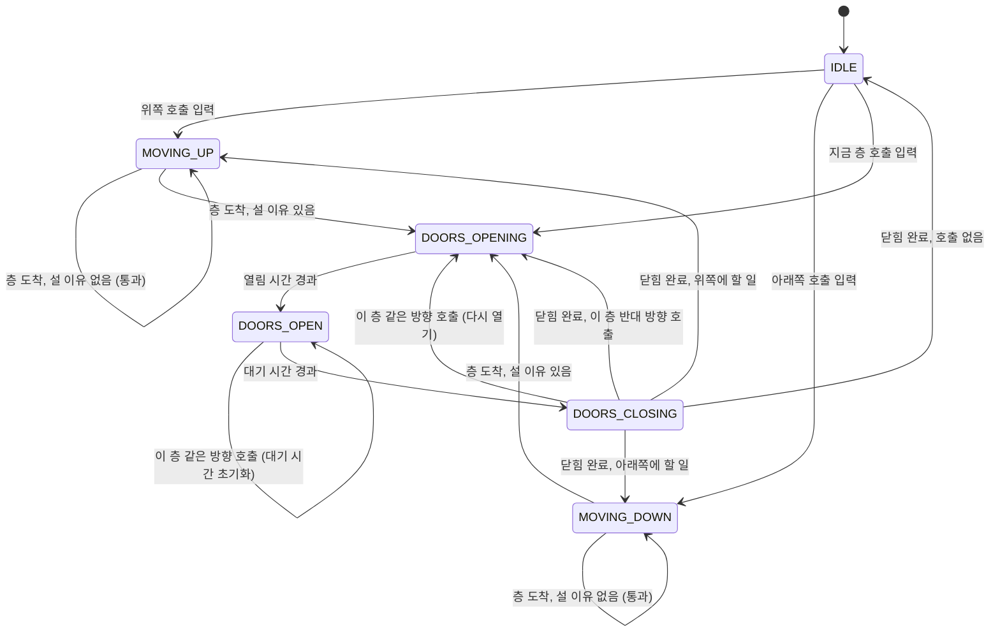

# 설계 문서: 단일 엘리베이터 시뮬레이션 엔진 (1단계)

엔진 코드는 `app/simulation/`에 있습니다. 순수 파이썬이고 I/O, asyncio, 실제 시계에 의존하지 않습니다.

## 1. 상태 머신

### 상태를 이렇게 나눈 이유

| 상태 | 의미 | 왜 따로 두는가 |
|---|---|---|
| `IDLE` | 서 있고, 문 닫힘, 할 일 없음 | 새 호출이 오면 "바로 판단"해야 하는 유일한 상태 |
| `MOVING_UP` / `MOVING_DOWN` | 층 사이를 이동 중 | 화면에 화살표를 그리고, 운행 기록에서 이동 시간·거리를 셀 때 방향이 바로 보인다 |
| `DOORS_OPENING` | 문이 열리는 중 | 시간이 걸리는 동작이다. 닫히는 중에 다시 열 때 "닫힌 만큼만" 여는 계산에 필요 |
| `DOORS_OPEN` | 문이 완전히 열려 있음 | 이때만 승객이 타고 내린다. 같은 층 호출이 오면 대기 시간을 다시 센다 |
| `DOORS_CLOSING` | 문이 닫히는 중 | 실제 엘리베이터처럼 이 층 버튼을 누르면 다시 열린다 |

- **문 상태를 셋으로 나눈 이유**: "문 열림" 하나로 합치면, 닫히는 중에 버튼을 눌렀을 때 다시 여는 동작과 시간 계산을 표현할 수 없습니다. 나중에 6단계(고장 감지)에서 "문이 N초 넘게 닫히지 않음" 같은 규칙을 만들 때도 상태가 나뉘어 있어야 합니다.
- **상태(`state`)와 진행 방향(`direction`)을 따로 둔 이유**: 상태는 "지금 물리적으로 하는 일", 방향은 "다음에 어느 쪽으로 갈 의도인지"입니다. 문이 열려 있는 동안에도 방향을 기억해야 같은 방향 홀 호출만 처리하고, 문이 닫힌 뒤 어느 쪽으로 갈지 정할 수 있습니다. 이동 중에는 `MOVING_UP`이면 항상 `direction == UP`이고, `IDLE`이면 항상 `NONE`입니다(테스트로 확인하는 불변식).
- **고려했지만 쓰지 않은 상태**:
  - `STOPPING`(감속): 층에 닿기 전에 정지를 결정하는 모델입니다. 현실적이지만 "이미 감속 거리 안이라 못 서는" 규칙이 추가로 필요합니다. 1단계에서는 층에 도착하는 순간 정지를 결정하는 것으로 단순화했습니다.
  - `OUT_OF_SERVICE`(고장, 점검): 6단계에서 추가합니다.

### 상태가 바뀌는 사건은 두 가지뿐

1. **시간 경과** `tick(dt_ms)`: 이동, 문 동작처럼 시간이 걸리는 일이 끝나면 다음 상태로 갑니다.
2. **호출 입력** `press_car_button`, `press_hall_button`: `IDLE`이면 곧바로 판단해 출발하고, 문이 열린 층의 호출이면 그 자리에서 처리합니다. 이동 중에 들어온 호출은 다음 층에 도착할 때 반영됩니다.

이렇게 나누면 상태 전이가 일어나는 곳이 `_complete_phase`(시간)와 `_on_new_call`(입력) 두 군데로 모여서 추적하기 쉽습니다.

## 2. 운행 방식: LOOK

**규칙**: 진행 방향 앞쪽에 호출이 남아 있으면 그 방향으로 계속 가며, 지나가는 층의 카 호출과 *같은 방향* 홀 호출에서 섭니다. 앞쪽에 더 할 일이 없으면 방향을 바꿉니다.

층에 도착했을 때 서는 조건 (`Elevator._on_arrive`):

- 그 층의 카 호출이 있다
- 그 층에 진행 방향과 같은 홀 호출이 있다
- 진행 방향 앞쪽에 더 할 일이 없다 (반환점, 반대 방향 홀 호출을 태우고 방향을 바꾼다)

### 다른 방식과 비교

| 방식 | 동작 | 장점 | 단점 |
|---|---|---|---|
| **FCFS** (먼저 온 순서) | 호출이 들어온 순서대로 한 층씩 간다 | 가장 단순하고 공정해 보인다 | 1층→9층→2층→8층처럼 왔다 갔다 해서 이동 거리와 대기 시간이 크게 늘어난다. 지나가는 층의 손님을 태우지 않는다 |
| **SCAN** (엘리베이터 알고리즘) | 한 방향으로 **건물 끝까지** 간 뒤 방향을 바꾼다 | 굶주림(영원히 못 타는 호출)이 없다 | 호출이 없는 맨 위층, 맨 아래층까지 쓸데없이 간다 |
| **LOOK** (채택) | 한 방향으로 **마지막 호출까지만** 간 뒤 방향을 바꾼다 | SCAN의 장점(굶주림 없음, 지나가며 태우기)을 유지하면서 빈 구간 이동을 없앤다 | 방향 끝 쪽 손님은 한 바퀴를 기다릴 수 있다 |

- LOOK을 고른 이유: 실제 단일 엘리베이터의 동작(집합 제어)과 가장 비슷하고, SCAN보다 이동 거리가 짧습니다. 굶주림이 없다는 점은 `test_all_calls_are_eventually_served`(시드 20개)로 확인합니다. SCAN과의 차이는 `test_look_turns_at_last_call_not_at_top_floor`에 그대로 드러납니다.
- 이름은 디스크 스케줄링에서 온 것입니다. 디스크 헤드가 트랙을 오가는 문제와 엘리베이터가 층을 오가는 문제가 같은 구조라서 같은 이름을 씁니다.

### 세부 규칙 (애매한 경우를 어떻게 정했는가)

- **반대 방향 홀 호출**: 올라가는 중에 "내려감" 버튼을 누른 층은 지나칩니다. 그 손님이 타면 반대쪽으로 끌려가기 때문입니다. 단, 그 층이 진행 방향의 마지막 호출이면 그 층이 반환점이 되어 섭니다.
- **문이 열린 동안 들어온 호출**
  - 지금 층의 카 호출, 같은 방향 홀 호출: 등록하지 않고 바로 처리합니다. `DOORS_OPEN`이면 대기 시간을 처음부터 다시 세고, `DOORS_CLOSING`이면 문을 다시 엽니다(닫힌 만큼만 다시 열리므로 그만큼 시간이 걸림).
  - 지금 층의 반대 방향 홀 호출: 남겨 두고 나중에 처리합니다.
  - 다른 층 호출: 등록만 하고, 문이 닫힌 뒤 판단합니다(문을 연 채 출발하지 않음).
- **대기 중 첫 출발 방향**: 가장 가까운 호출 쪽, 거리가 같으면 위쪽입니다. 대기 중에는 호출이 들어오는 즉시 판단하므로, 이 규칙은 문이 열린 동안 여러 호출이 쌓였을 때만 쓰입니다.
- **같은 호출 중복**: 호출을 집합(`set`)에 담으므로 여러 번 눌러도 한 번만 남고, 한 번만 섭니다.
- **맨 위층의 올라감, 맨 아래층의 내려감**: 실제로 버튼이 없으므로 `ValueError`로 거절합니다. 거절된 호출은 상태를 바꾸지 않습니다.
- **호출을 지우는 시점**: 문이 열리기 시작할 때(`DOORS_OPENING` 진입) 지웁니다. 실제 엘리베이터가 도착하면 버튼 불이 꺼지는 시점과 같습니다.

## 3. 시간과 결정성

### 정수 밀리초

시간은 `float` 초가 아니라 `int` 밀리초입니다.

- `0.1`을 10번 더하면 `0.9999999999999999`가 되어 `1.0`과 같지 않습니다. 도착 여부를 `>=`로 비교하면 한 tick 늦게 도착하는 일이 생기고, tick 크기에 따라 결과가 달라집니다.
- 정수는 이런 오차가 없습니다. `Fraction`이나 `Decimal`도 가능하지만 느리고, ms 해상도면 엘리베이터에는 충분합니다.

### tick 크기와 무관한 결과

`tick(dt_ms)`에서 한 동작이 dt보다 일찍 끝나면 남은 시간을 다음 동작에 넘깁니다(`while` 루프). 그래서 `tick(1)`을 6만 번 하든 `tick(60000)`을 한 번 하든 상태 기록(`history`)이 같습니다. 3단계 실시간 서버에서 tick 간격을 바꾸거나 4단계 실험에서 빠르게 돌려도 결과가 바뀌지 않습니다.

`Simulation.step`도 같은 원칙으로, tick 사이에 예약된 호출을 tick 경계로 미루지 않고 그 시각에 정확히 넣습니다.

### 같은 입력이면 같은 결과

- 엔진 자체에는 무작위성이 없습니다. 같은 호출을 같은 시각, 같은 순서로 넣으면 결과가 같습니다.
- 같은 시각의 호출은 예약한 순서대로 처리합니다(힙에 `(시각, 순번, 호출)`을 넣음). 같은 시각에 끝나는 동작(예: 문 닫힘 완료)이 있으면 동작이 먼저 끝나고 호출이 들어갑니다.
- 무작위 호출은 `traffic.py`에서만 만들고, 전역 `random`이 아니라 시드로 만든 `random.Random(seed)`를 씁니다. 전역 상태를 쓰면 다른 코드가 난수를 하나만 더 뽑아도 순서가 바뀌기 때문입니다.
- 홀 호출 집합의 순회 순서는 실행마다 달라질 수 있습니다(방향이 문자열이라 해시가 `PYTHONHASHSEED`에 따라 바뀜). 그래서 판단 로직은 `any`, 동점이 없는 `min`처럼 순서와 무관한 연산만 쓰고, 방향을 고를 때는 `(UP, DOWN)` 같은 고정된 순서로 확인합니다.

이 성질은 4단계에서 배차 알고리즘들을 **같은 시드, 같은 호출**로 비교하는 기반입니다.

## 4. 앞으로 바뀔 부분

- 2단계: 여러 대가 되면 시계(`now_ms`)를 `Simulation`이 갖고, 홀 호출은 배차 전략(Strategy 패턴)이 특정 카에 배정합니다. 카 호출은 지금처럼 각 카가 갖습니다.
- 4단계: 승객(출발층, 목적층, 도착 시각)을 모델링해 대기 시간과 탑승 시간을 측정합니다.
- 5단계: `history`(상태 변화 기록)를 운행 이벤트로 MySQL에 저장합니다.
